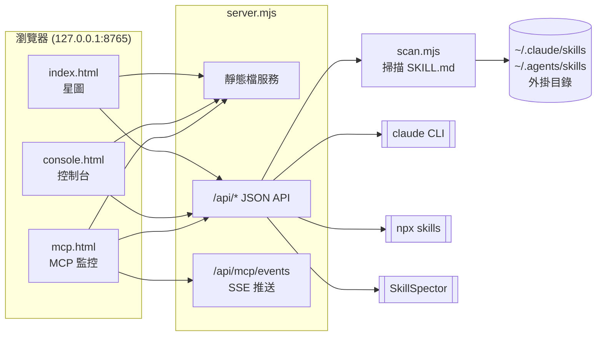

<div align="center">

# 🌌 技能星圖 Skills Galaxy

**把散落在電腦各處的 Claude Code 技能（Skills）與 MCP 伺服器，畫成一張可以點、可以管、可以檢查的星圖。**


[功能](#-功能總覽) · [快速開始](#-快速開始) · [三個頁面](#-三個頁面) · [架構](#-架構) · [安全設計](#-安全設計) · [API](docs/API.md) · [更新紀錄](CHANGELOG.md) · [疑難排解](#-疑難排解)

</div>

---

## ✨ 功能總覽

| | 功能 | 說明 |
|---|---|---|
| 🪐 | **技能星圖** | 掃描本機所有 `SKILL.md`，依來源分群、依互相引用畫出關聯線 |
| 🗂️ | **技能控制台** | 能力矩陣（來源 × 主題）、最常被引用排行、可執行指令一覽 |
| 🔌 | **MCP 監控** | 逐一實際連線每個 MCP 伺服器，即時推送健康度，可新增／移除／啟停 |
| ➕ | **新增技能** | 手動填寫、或讓本機 `claude` 代寫草稿 |
| 🔎 | **線上搜尋與安裝** | 查 [skills.sh](https://skills.sh) 目錄，一鍵 `npx skills add` |
| 🛡️ | **安全掃描** | 用 NVIDIA SkillSpector 靜態分析已安裝或待安裝的技能 |
| 🈶 | **繁中翻譯** | 英文描述一鍵交給本機 `claude` 翻成繁體中文，存成對照檔 |
| ♻️ | **回收資料夾** | 移除技能是「搬走」不是刪除，隨時可還原 |
| 🖼️ | **ChatGPT 產圖狀態** | MCP 頁顯示 chatgpt-web-image 專用 Chrome 與登入狀態，可一鍵開啟圖片資料夾 |

> 全部跑在你自己的電腦上：零外部套件、只監聽 `127.0.0.1`，不需要任何雲端服務。

---

## 🚀 快速開始

### 需求

| 項目 | 版本 / 說明 | 必要？ |
|---|---|---|
| [Node.js](https://nodejs.org) | 22 以上（用到內建 `WebSocket`） | ✅ |
| [Claude Code CLI](https://docs.claude.com/claude-code) | 指令 `claude` 在 PATH 中 | MCP 監控、AI 翻譯／代寫需要 |
| `npx` | 隨 Node.js 附帶 | 線上安裝技能需要 |
| SkillSpector | NVIDIA 技能安全掃描器 | 只有「安全掃描」需要 |

### 啟動

**方法一：雙擊 `start.bat`**（Windows）

會檢查 Node、避免重複啟動，並自動開啟 <http://127.0.0.1:8765/mcp.html>。

**方法二：命令列**

```powershell
node server.mjs
```

然後開啟 <http://127.0.0.1:8765>。

**方法三：純靜態（不用伺服器）**

```powershell
node scan.mjs
```

產生 `skills-data.js` 後直接用瀏覽器開 `index.html`，可以瀏覽星圖，但新增／移除／MCP 等管理功能不可用。

---

## 🖥️ 三個頁面

頁面頂端的導覽列可在三頁之間切換：**星圖 · 控制台 · MCP**。

### 1. 🪐 星圖 `index.html`

- 每顆星是一個技能，顏色代表來源（個人技能、`.agents` 共用、各外掛、claude.ai 遠端外掛）
- 技能說明裡互相提到對方名稱，就會連一條線
- 點星星看詳情：描述（含繁中翻譯）、路徑、從 `SKILL.md` 抽出的可執行指令
- **管理技能** 面板：
  - `＋ 新增技能`：手動新增 / AI 代寫 / 線上搜尋 / 貼來源安裝
  - `檢查更新`：重新掃描並列出與上次的差異
  - `AI 翻譯全部`：把尚未翻譯的英文描述一次翻完
  - `安全掃描`：掃描選取的技能、全部個人技能，或安裝前的來源
  - `回收資料夾`：還原被移除的技能

### 2. 🗂️ 控制台 `console.html`

- **能力矩陣（來源 × 主題）**：一眼看出哪個來源偏重哪類能力
- **最常被其他技能引用**：找出你技能庫的核心節點
- **技能 / 指令** 分頁切換、篩選與清除篩選

### 3. 🔌 MCP 監控 `mcp.html`

- 讀取 `claude mcp list`，再對每台伺服器各自跑 `claude mcp get`（最多 24 個並行）
- 結果透過 Server-Sent Events 即時推送，最慢的伺服器最先開始檢查
- **自動檢查**：每 5 分鐘 / 每 15 分鐘
- **新增 MCP 伺服器**：內建「本機程式」與「遠端 HTTP」兩種 JSON 範本
- **啟用／停用**：使用者設定的伺服器會暫存設定後移除；外掛提供的則整個外掛一起切換
- 在別處（終端機 `claude mcp add`、`/plugin`）改了設定，頁面也會即時更新

---

## 🏗️ 架構



### 檔案說明

```text
skills-galaxy/
├── index.html              # 星圖主頁 + 技能管理面板
├── console.html            # 控制台：能力矩陣、引用排行、指令一覽
├── mcp.html                # MCP 監控與管理
├── mcp-icons.js            # MCP 伺服器圖示對照
├── mcp-descriptions.zh-TW.js  # MCP 伺服器繁中說明
├── server.mjs              # 本機 HTTP 伺服器與全部 API
├── scan.mjs                # 掃描器：找 SKILL.md、解析 frontmatter、算關聯、抽指令
├── descriptions.zh-TW.json # 技能描述繁中對照（可手動編輯或 AI 翻譯）
├── commands.zh-TW.json     # 指令說明繁中對照
├── start.bat               # Windows 一鍵啟動
├── CHANGELOG.md            # 更新紀錄
├── docs/
│   └── API.md              # HTTP API 參考
│
│  ── 以下為執行時產生，已列入 .gitignore ──
├── skills-data.js          # node scan.mjs 的輸出（含本機路徑）
└── mcp-state.json          # 上次 MCP 檢查結果
```

### 掃描來源

`scan.mjs` 依序掃描以下根目錄（最深 8 層）：

| 來源名稱 | 路徑 | 可由本工具移除 |
|---|---|---|
| 個人技能 | `~/.claude/skills` | ✅ |
| `.agents` 共用 | `~/.agents/skills` | ✅ |
| anthropic-skills | `%APPDATA%/Claude/local-agent-mode-sessions/skills-plugin` | ❌ |
| 各外掛 | `installed_plugins.json` 記錄的現用版本路徑 | ❌ |
| claude.ai 遠端外掛 | 遠端外掛快取目錄 | ❌ |

只有「自有根目錄的直接子資料夾」能被移除；外掛內的技能請用 `/plugin` 管理。

---

## 🔐 安全設計

這個工具能新增、移除檔案並呼叫外部指令，所以有幾道防線：

- **只聽本機**：伺服器綁 `127.0.0.1`，並檢查 `Host` 標頭只接受 `127.0.0.1:8765` / `localhost:8765`（擋 DNS rebinding）
- **防跨站請求**：所有 `POST` 必須同源（`Origin` 等於本機網址）並帶自訂標頭 `X-Skills-Galaxy: 1`，其他網站送不出來
- **請求大小上限**：JSON 內容超過 300 KB 直接回 413
- **白名單驗證**：技能名稱 `^[a-z0-9][a-z0-9-]{0,62}$`；安裝來源只收 `owner/repo` 或 `https://github.com/...`，字元集不可能夾帶 shell 語法
- **自由文字不進命令列**：AI 代寫、翻譯、MCP 設定 JSON 一律經 **stdin** 傳給 `claude`
- **刪除可復原**：移除技能 → 搬到 `~/.claude/skills-trash`；移除 MCP → 回傳原設定供前台復原
- **金鑰不放專案**：停用的 MCP 設定（可能含金鑰）暫存在 `~/.claude`，不在本資料夾
- **ChatGPT 除錯埠只連本機**，且只做唯讀檢查、不導航
- **個人資料不進版控**：`skills-data.js`、`mcp-state.json` 已列入 `.gitignore`

---

## 🈶 翻譯對照檔

`descriptions.zh-TW.json` 是 `{ "技能名稱": "繁中描述" }` 的對照表：

```json
{
  "pdf": "當使用者想對 PDF 檔案做任何事時使用這個技能……"
}
```

- 在星圖詳情裡手動修改會呼叫 `POST /api/zh` 寫回
- `AI 翻譯全部` 只翻譯「還沒有中文、且原文不含中文」的描述
- 只會寫入目前確實存在的技能名稱，避免留下孤兒條目

---

## 🧪 自我檢查

沒有獨立的測試框架，檢查直接寫在程式裡，啟動時就會跑：

- `scan.mjs`：斷言每條關聯都指向存在的技能、至少掃到一個 `SKILL.md`、指令抽取器的範例輸出正確
- `server.mjs`：啟動時驗證 `claude mcp list` 的輸出格式，CLI 改版會第一時間報錯

```powershell
node scan.mjs   # 掃描 + 自我檢查，成功會寫出 skills-data.js
```

---

## 🩺 疑難排解

| 症狀 | 可能原因 | 處理 |
|---|---|---|
| `start.bat` 顯示「找不到 node」 | Node 未安裝或不在 PATH | 安裝 Node.js 22+，或在 ServBay 啟用 Node.js |
| 開頁面是空白星圖 | 還沒產生 `skills-data.js` | 用 `node server.mjs` 啟動，或先跑 `node scan.mjs` |
| `EADDRINUSE :8765` | 伺服器已在執行 | 直接開 <http://127.0.0.1:8765>，或關掉舊視窗 |
| MCP 頁全部「逾時」 | `claude` 不在 PATH | 在終端機確認 `claude --version` 能執行 |
| 回應 403 | 用了 `127.0.0.1` 以外的網址開頁面 | 改用 `http://127.0.0.1:8765` |
| 安全掃描失敗 | 未安裝 SkillSpector | 安裝後重新啟動伺服器 |

---

<div align="center">

由 Node.js 原生模組打造 · 零相依 · 資料不離開你的電腦

</div>
